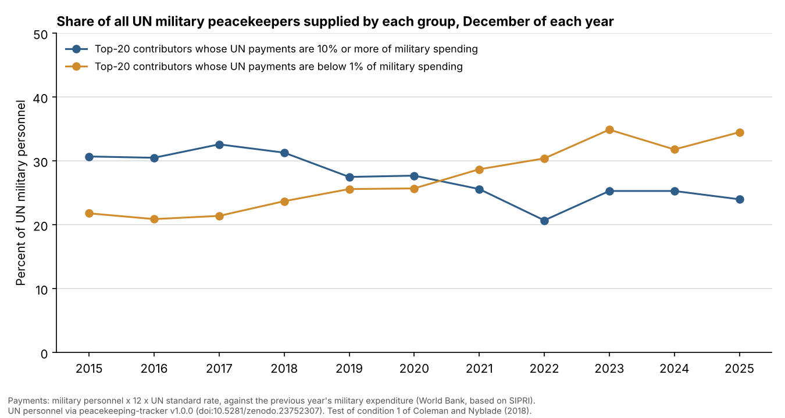
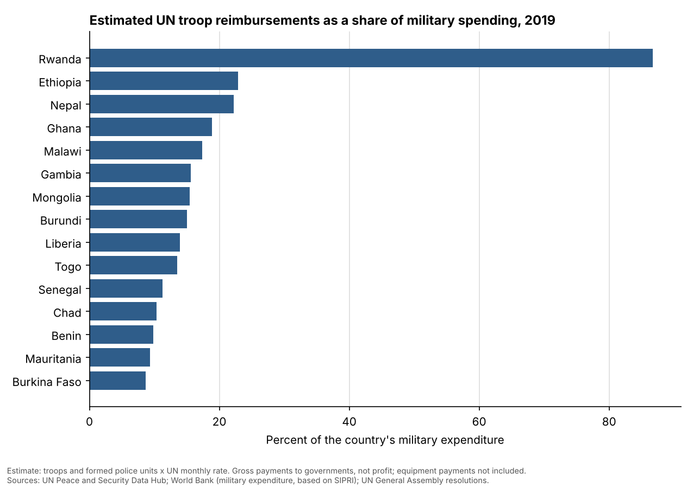

# peacekeeping-for-profit-update

[](https://doi.org/10.5281/zenodo.23768249)

Do poorer countries send soldiers to UN peacekeeping missions to earn money? This project builds the data needed to test that question with recent figures, following the argument of Coleman and Nyblade (2018).

## Main result

Coleman and Nyblade's first condition says profit is a plausible motive only where a deployment's UN payments are large relative to the country's military spending and armed forces. Applied to the 20 largest military contributors every December from 2015 to 2025:

- In **December 2015**, the top contributors whose UN payments came to **10% or more** of their military spending supplied **30.7%** of all UN military peacekeepers. Top contributors for whom the payments were **below 1%** supplied **21.8%**.
- By **December 2025** the two had swapped places: **24.0%** and **34.5%**.
- Across **all** contributors, the number of countries whose payments reached 10% of military spending fell from **14 in 2015 to 4 in 2025**: Rwanda, Nepal, Ghana and Malawi.

So the group for which "peacekeeping for profit" is even plausible was limited in 2015, as the authors argue, and has become smaller since. The condition says when profit is *possible*; it does not show that these countries contribute *for* profit.



### How condition 1 is measured

For each December, for every contributing country:

- **Military personnel** = troops + staff officers + experts on mission deployed that month.
- **Annual payment** = military personnel x 12 x the UN standard monthly rate in force that December.
- **Payment share** = annual payment as a percent of the **previous year's** military expenditure (World Bank, based on SIPRI).
- **Deployment share** = military personnel as a percent of the **same year's** armed forces (World Bank, based on IISS; available only to 2020).

The article gives no numeric cut-off for "very significant". This project uses **10%** as its reading and also reports **5%** and **20%** in the summary table, so the result can be checked under other cut-offs. **Condition 2**, an exceptional ability to profit through cheap equipment or low deployment allowances, depends on national policies that public data does not show, so it is not tested here.



## What this is and why it matters

The UN does not have its own army. Countries lend it soldiers and police, and the UN pays those governments a fixed amount per soldier per month: US$1,448 from July 2022, rising to US$1,474.68 in July 2026. For a rich country this is small, but for a poor country with a small military budget it can be a large source of money. That has led to a popular claim that some countries send peacekeepers mainly for profit.

Coleman and Nyblade (2018) argue that this claim is overstated: profit can plausibly explain contributions only when a country's deployment is large compared with its armed forces and military spending, and only for a limited group of countries. This repository brings together the data to check that argument with figures up to 2026, building on the UN troop data in peacekeeping-tracker: how many personnel each country sent every month since 1990, the size of its armed forces, its military spending, and an estimate of what the UN owed it.

It can be used to see which countries depend most on UN payments, how that changed as missions closed, and to test claims about "peacekeeping for profit" with official numbers.

## The reference study and the data it builds on

Katharina P. Coleman and Benjamin Nyblade. 2018. "Peacekeeping for profit? The scope and limits of 'mercenary' UN peacekeeping." *Journal of Peace Research* 55 (6): 726-741. https://doi.org/10.1177/0022343318775784

The authors' data and code are not in the journal's replication archive, so this is an update built from public sources, not a replication of their files.

The UN troop-contribution data comes from **peacekeeping-tracker v1.0.0** (Azom 2026, https://doi.org/10.5281/zenodo.23752307), which joins the UN's monthly files into one checked series for November 1990 to July 2026. This repository pins that release and rebuilds its data, rather than keeping its own copy.

## Why the full dataset is not in this repository

The UN's terms of use allow its data to be downloaded for personal, non-commercial use, but not redistributed. So this repository does **not** contain the UN's files or the full panel built from them. It contains the code that rebuilds everything on your own computer, a check that the rebuild matches peacekeeping-tracker v1.0.0, short summary tables, and charts. The World Bank data (CC BY 4.0) is included.

## The summary tables

| File | What it holds |
|---|---|
| [`tables/condition1_summary_by_december.csv`](tables/condition1_summary_by_december.csv) | Condition 1 by December, 2015-2025: how many of the top 20 contributors are at or above 5%, 10% and 20%, or below 1%, and the share of all UN military personnel each group supplies; plus every country at or above 10% |
| [`tables/condition1_top20_by_december.csv`](tables/condition1_top20_by_december.csv) | The 20 largest military contributors each December, 2015-2025, with their payments, military spending, armed forces and both shares |
| [`tables/reimbursement_share_summary_by_year.csv`](tables/reimbursement_share_summary_by_year.csv) | By year, 2015-2025: total estimated reimbursement owed, and how many countries' payments exceed 5%, 10% and 25% of their military spending |
| [`tables/reimbursement_share_top20_2019.csv`](tables/reimbursement_share_top20_2019.csv) | The 20 countries with the highest estimated payments relative to military spending in 2019 |
| [`tables/reimbursement_share_top20_2025.csv`](tables/reimbursement_share_top20_2025.csv) | The same for 2025 |

## The full panel (rebuilt on your computer)

`data/build/panel_country_year.csv`, one row per country per year, 1990-2026 (3,909 rows, 162 countries), and `data/build/panel_country_month.csv`, one row per country per month.

| Column | Meaning |
|---|---|
| `avg_troops`, `avg_staff_officers`, `avg_experts_on_mission`, `avg_police_individual`, `avg_police_formed_units`, `avg_police_unsplit`, `avg_police_total` | Average personnel deployed over the year, by category (categories as in peacekeeping-tracker) |
| `avg_contingent` | Troops plus formed police units: the units the UN reimburses at its standard monthly rate |
| `avg_total_uniformed` | All uniformed personnel |
| `months_with_data`, `months_contributing` | Months the UN has data for that year, and months the country had anyone deployed |
| `est_reimbursement_usd` | Contingent x the UN standard monthly rate, summed over the year (2015-2025, years with a rate in every month) |
| `armed_forces_personnel` | Size of the armed forces (World Bank; available to 2020) |
| `military_expenditure_usd`, `military_expenditure_pct_gdp` | Military spending (World Bank, based on SIPRI) |
| `gdp_per_capita_usd` | Income per person (World Bank) |
| `contingent_pct_of_armed_forces` | Deployed contingents as a percent of the armed forces |
| `reimbursement_pct_of_military_expenditure` | Estimated payments owed as a percent of military spending |

## Read this first

- **The reimbursement is an estimate of money owed to governments at the standard rate, not profit or cash paid.** Countries pay their own costs of deploying, the UN often pays late, and how much reaches individual soldiers varies.
- **Equipment payments are not included.** The UN also pays separately for contingent-owned equipment.
- **Before May 2017 the UN counted staff officers inside troops**, so contingents and reimbursements for those years are slightly overstated.
- **Yearly averages count months with no contribution as zero.** The UN's own annual statistics average each category only over the months it was reported, which overstates countries that joined or left a mission during the year.
- 1990 and 2026 are partial years (2 and 7 months).
- **Condition 1 counts all military personnel**, including staff officers and military experts, who are not paid through the standard troop rate. This follows the article's own approach, and slightly overstates the payment share.
- **Military spending figures are revised over time**, so shares for earlier years can differ from those printed in the article.

## How the numbers were checked

Run by [`code/02_check_panel.py`](code/02_check_panel.py); results in [`data/check_report.md`](data/check_report.md).

1. peacekeeping-tracker v1.0.0's own checks pass on the rebuilt UN data, including its confirmation that the rebuild matches that release.
2. The panel's world totals equal peacekeeping-tracker's published monthly totals in all 429 months.
3. Every reimbursement rate used comes from peacekeeping-tracker's rate table, which names the General Assembly resolution and paragraph that set it.
4. Partial years are flagged, and impossible values (more personnel deployed than the whole armed forces) are screened.
5. The condition 1 measures follow fixed rules, applied the same way to every year, so a change in the result comes from the data, not the method.

## Reproduce it

Needs Python 3.10 or later, git and an internet connection.

```
pip install -r requirements.txt
python code/00_get_un_data.py      # clones peacekeeping-tracker v1.0.0, downloads and checks the UN data
python code/01_build_panel.py
python code/02_check_panel.py
python code/03_tables_figures.py
python code/04_condition1.py
```

## Sources and license

Sources are in [`data/README.md`](data/README.md). Code: MIT (see [`LICENSE`](LICENSE)). The summary tables and charts are made from the UN's figures; please credit this project, peacekeeping-tracker and the UN. The World Bank data: CC BY 4.0.

## Cite

Azom, Kazi Affnann (2026). *peacekeeping-for-profit-update: UN peacekeeping contributions, military capacity and UN reimbursements by country, 1990-2026* (Version v1.0.0) [Software]. Zenodo. https://doi.org/10.5281/zenodo.23768250

- This version (v1.0.0): [10.5281/zenodo.23768250](https://doi.org/10.5281/zenodo.23768250)
- All versions (always points to the latest): [10.5281/zenodo.23768249](https://doi.org/10.5281/zenodo.23768249)

Please also cite the UN personnel data source, peacekeeping-tracker v1.0.0 (https://doi.org/10.5281/zenodo.23752307), and Coleman and Nyblade (2018). See [`CITATION.cff`](CITATION.cff).
